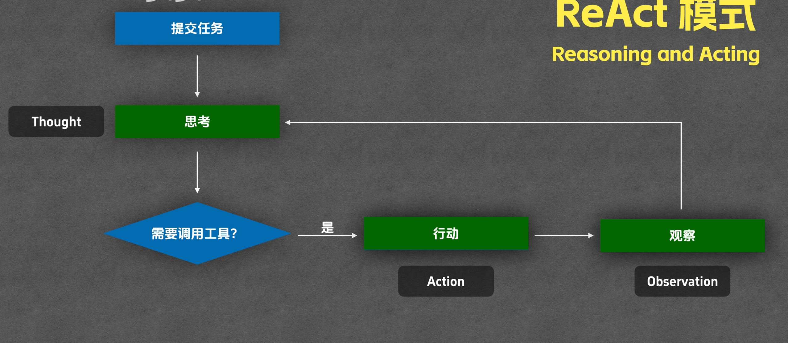
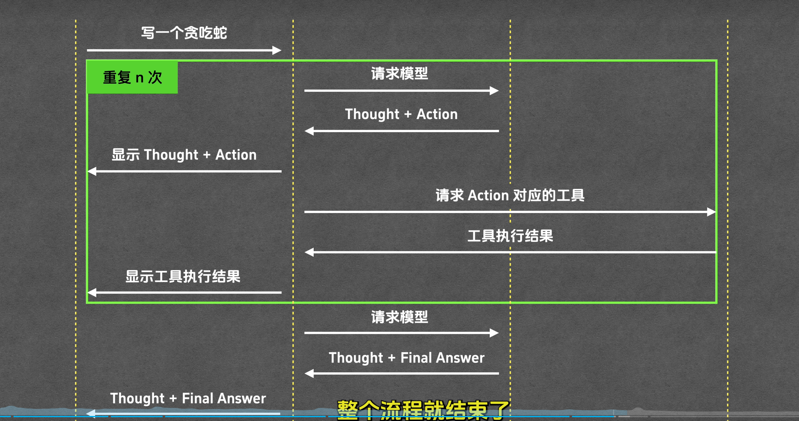
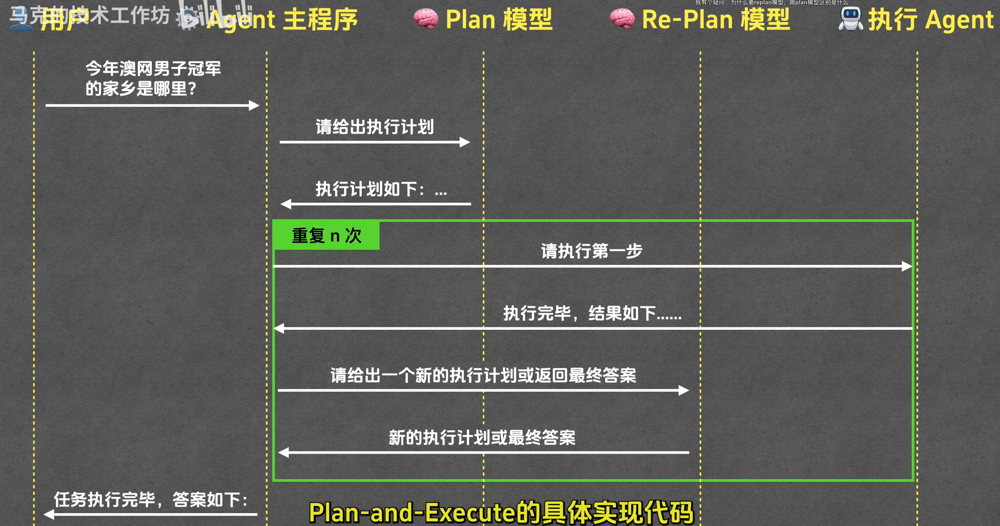
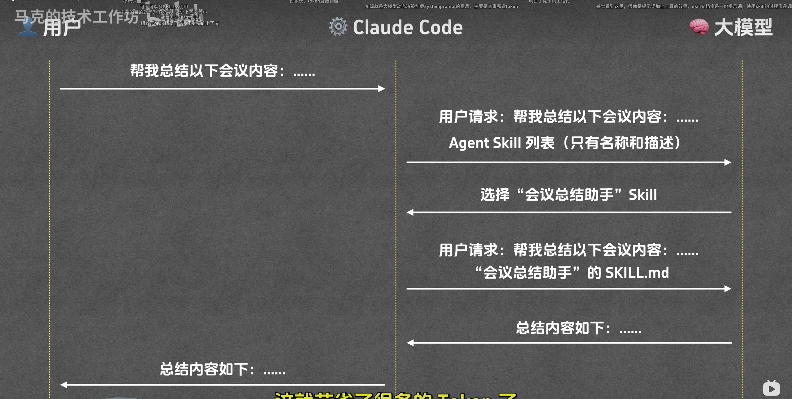
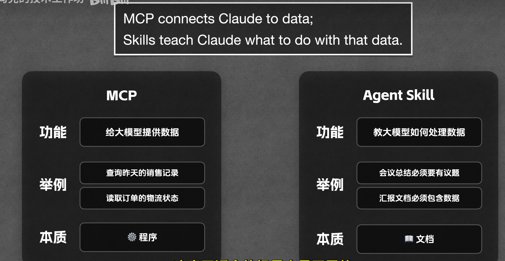

# AI相关名词解释

## LLM
大模型 大脑

大模型不能直接调用工具，他是向平台（agent组件）请求调用工具，agent组件调用工具后将结果返回给大模型

## Prompt

分为系统提示词，和用户提示词

### System Prompt
### User Prompt

## Tool

Tool 工具，就是函数，agent组件可以调用它得到返回值。

## MCP

是一套提供给llm平台调用的工具接入规范。
（统一的工具接入标准） 

- tip: 工具是平台调用的，平台调用后将结果给llm
 
## Agent

前提：大模型无法感知和改变外界环境。工具可以使其具备这些能力。

自主规划，自主调用工具，持续工作直至完成用户任务的系统就是agent

比如：
- claude code
- codex

Agent 的构建模式：
- ReAct
- Plan and Execute 

### ReAct

### Plan and Execute
- 先规划再执行

## Skills

可以把它理解为一个动态加载的prompt

SLILL.md 文件： 渐进式披露
- 元数据层 ： 所有skill的元数据层都会被加载
- 指令层 ： 运行到需要的skill才会加载
- 资源层 ： 当前skill需要的时候才会用到
  - reference
  - script

特点：渐进式披露，按需加载

### reference
reference 是条件触发的，减少token使用

### script
代码只会执行，不会读取，不会占用模型上下文

简单用法

### 与mcp区别

## SubAgent
它和skill的区别就是它会有独立的上下文窗口，把执行的结果交给主agent

## Plugin
将 skill，hook，subagent，mcp等打包到一起

tip:
 rules, skills 本质来说都是prompt，rule偏向于系统的规则，skill则是单个技能的模板提示词
